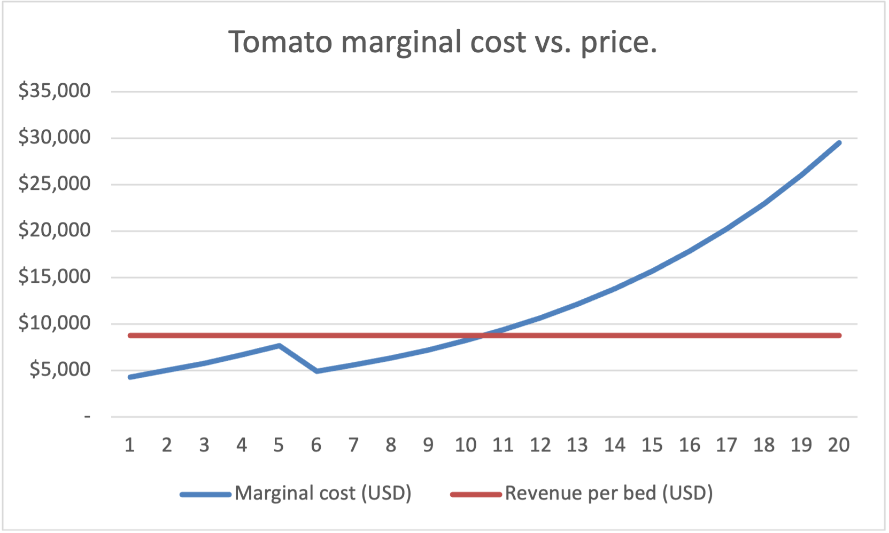
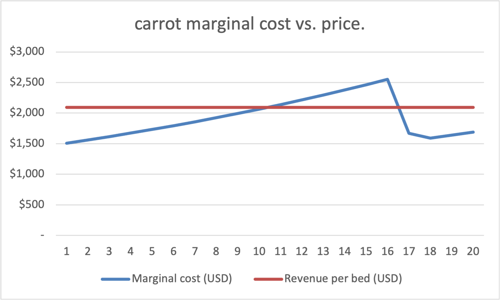

# Perfect Competition — analysis

## 1. Where the money crop stops
Tomatoes earn the most per bed ($8800), but Solver plants only 10 of the
20 allowed. The cap is not what stops them; marginal cost is. The 10th bed
costs $8249 (MC_Schedule F15), below the $8800 price, so it adds $551 of profit.
The 11th costs $9391 (F16), above price, so it would lose $591. Tomatoes stop
where MC crosses price, not at the cap (Figure 1).

The highest-paying crop is also the most labor-hungry: its crowding rate
(10%) means each extra bed slows every bed, so its MC climbs fastest.

## 2. Binding and slack constraints
| Constraint | Value | Limit | Status | Worth of +1 |
|---|---|---|---|---|
| Tomato cap | 10 | 20 | Slack | $0 |
| Carrot cap | 20 | 20 | Binding | ≈ $352 |
| Mesclun cap | 30 | 30 | Binding | ≈ $246 |
| Total bed | 60 | 64 | Slack | $0 |
| Temps | 3.165 | 4 | Slack | $0 |

I estimated each binding constraint's worth by raising its limit by one and
re-running Solver: one more Carrot bed raises profit from $42762, to $43114
(≈ $352); one more mesclun bed, to $43008 (≈ $246). Slack constraints are worth
$0 because the plan does not use all of them now; more room changes nothing.
Total bed slots are not the problem (60 of 64 used); the crop caps are.

## 3. Why marginal cost falls
Carrot MC rises until bed 16, then drops from $2552 to $1671 at bed 17
(MC_Schedule N21 → N22), before climbing again (Figure 2). Bed 17 is the
first where the farmer's hours run out (temp count, column L, goes from 0
to 0.039). From that point the next hour is paid at the temp rate ($17.36/hr)
instead of the farmer's ($34.72/hr), so the cost of one more bed falls even
though the physical crowding effect keeps growing. The dip is a wage effect,
not a change in productivity.

Tomato MC rises until bed 5, then drops from $7661 to $4906 at bed 6
(MC_Schedule F10 → F11), before climbing again. Bed 6 is the
first where the farmer's hours run out (temp count, column D, goes from 0
to 0.16).

Mesclun MC rises until bed 13, then drops from $2988 to $2523 at bed 14
(MC_Schedule V18 → V19), before climbing again. Bed 14 is the
first where the farmer's hours run out (temp count, column T, goes from 0
to 0.021).

## 4. Would each crop make money alone?
At each crop's standalone crossing point:

| crop | beds | Price | MC | AVC | Profit alone, incl. $20,000 fixed-costs |
|---|---|---|---|---|---|
| Tomato | 10 | $8,800 | $8249 | $6183 | +$6,173 |
| Carrot | 10 | $2,094 | $2066 | $1773 | −$16,794 |
| Mesclun | 6 | $2,700 | $2667 | $2563 | −$19,180 |

All three cover their variable costs (price > AVC), so each is worth
producing in the short run. Carrot and Mesclun lose money only once they
carry all the fixed-costs alone. Fixed-costs is paid whether or not they are planted, so it
is not a reason to stop. As long as price exceeds AVC, each extra bed
helps pay the fixed-costs rather than adding to it.

## 5. My hypothesis vs. the model
In my brief I predicted 14 Tomato / 20 Carrot / 30 Mesclun, reasoning
that because carrots and mesclun get more expensive so slowly that they stay profitable all the way to their caps, and tomatoes take the remaining 14 beds. I was wrong once: Tomatoes stop at
10 because their MC rises fastest, and the bed was never the binding limit
(60 of 64 slots). I assumed the land was binding, and tomatoes stopped at 10 because MC crossed price first. I predicted correctly that carrots and mesclun do reach their caps.
